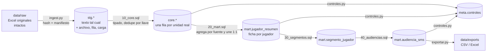
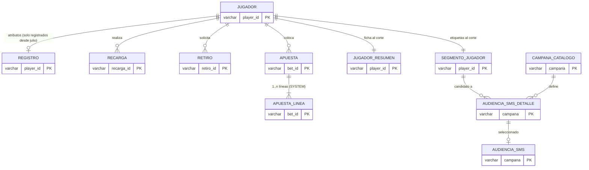

# 2. Arquitectura y modelo de datos

## Por qué DuckDB + scripts versionados

| Criterio | Situación actual | Implicación |
|---|---|---|
| Volumen | ~1,4 M filas por trimestre; ~6 M al año | Cabe en una base analítica local; las consultas responden en segundos |
| Frecuencia | Cargas mensuales en Excel | No requiere servicios corriendo ni orquestadores |
| Usuarios | Un equipo analítico pequeño | Un archivo `.duckdb` y un repositorio Git bastan |
| Costo y operación | Cero licencias; `pip install` | Lo puede operar un analista |
| Crecimiento | Cargas diarias, más usuarios o integración SMS | La misma lógica SQL migra a MotherDuck, BigQuery o Postgres |

Se descartó SQLite porque es más lento en agregaciones de millones de filas y no lee
columnar. Una solución en la nube se justifica cuando: (a) haya cargas diarias automáticas
desde el back office, (b) varias personas consulten a la vez, o (c) el proveedor SMS necesite
leer audiencias por API. Ninguna de las tres ocurre hoy.

## Capas

| Capa | Dónde | Qué guarda | Regla |
|---|---|---|---|
| Originales | `data/raw/` | Los Excel tal como llegan | Nunca se modifican ni se borran |
| Control | `meta.manifiesto`, `meta.controles` | Archivo, hash, fuente, filas, periodo, estado, conciliación | Auditoría de cada carga y corrida |
| Staging | `stg.registros`, `stg.recargas`, `stg.retiros`, `stg.apuestas` | Valores como texto + `_load_id`, `_archivo`, `_sha256`, `_fila` | Solo se agrega; conserva lo reemplazado |
| Core (datos limpios) | `core.*` | Tipos correctos, llaves únicas, teléfonos normalizados | Se reconstruye completo en cada corrida |
| Mart (consumo) | `mart.*` | Ficha por jugador, segmentos, audiencias, parámetros | Se recalcula con la fecha de corte indicada |

## Diagrama de relaciones

`core.jugador` es el universo: todo `player_id` visto en cualquier fuente.
La ficha se construye **agregando cada fuente por separado** y uniendo los resultados 1 a 1
por `player_id`; así un jugador con 100 recargas y 500 apuestas nunca produce 50.000 filas.
Los controles verifican que la suma de la ficha sea idéntica a la de `core`.

## Reglas de consolidación

| Tema | Regla |
|---|---|
| Identidad | `player_id` = `ID` (Registros) = `Client ID` (demás fuentes), guardado como texto. No se unen personas por nombre, correo ni teléfono |
| Teléfono | Solo dígitos; 10 dígitos iniciando en 3 = válido; 12 dígitos iniciando en 573 = válido sin prefijo; lo demás inválido. Nunca se completan dígitos |
| Conflictos | Teléfono, correo o documento compartido por varios `player_id` se marca (`jugadores_mismo_*`) y el teléfono compartido se excluye de SMS |
| Duplicados exactos de archivo | Mismo SHA-256 → no se carga; queda en el manifiesto |
| Duplicados de registro | Si la misma llave aparece en varias cargas activas, gana la carga más reciente (`_load_id` mayor) |
| Correcciones de meses anteriores | Un archivo nuevo de la misma fuente que **contiene el periodo** de uno anterior y comparte con él **≥ 50 % de sus identificadores** lo reemplaza: el anterior queda `reemplazado` y deja de alimentar `core`. Las partes de un mismo mes (rangos distintos, identificadores distintos) conviven |
| Operaciones reversadas o anuladas | Los exports actuales solo traen exitosas. En apuestas, `Void`/`Refund` quedan como ticket `anulada_o_reembolsada` y `Running`/`Reopen` como `abierta`; se cuentan como apuestas colocadas pero se separan en el resultado agregado |
| Fecha de registro | De Registros; si no está, la `Registration Date` que reporta Retiros; si no, desconocida |
| Fecha de corte | Parámetro explícito (`config.FECHA_CORTE`). Operaciones posteriores al corte no entran a la ficha |
| Trazabilidad | Cada fila de `core` conserva `origen_archivo`, `origen_load_id` y `origen_fila` |
| Datos personales | `core.registro` no guarda nombre, dirección, documento ni IP. Las exportaciones con teléfono quedan fuera de Git |

## Controles de conciliación

Ver `reports/controles.csv` (se regenera en cada corrida). Se controla:

| Control | Qué verifica |
|---|---|
| Archivo → staging | Filas de cada archivo cargado = filas en staging |
| Staging → core | Llaves únicas en staging activo = filas en core, y montos iguales (recargas, retiros netos, apostado, casino) |
| Líneas → tickets | Los tickets conservan el monto de sus líneas y cuentan `Bet ID` distintos |
| Core → ficha por jugador | Cantidad y monto de recargas, apuestas, rondas de casino y retiros, hasta el corte |
| Unicidad | Una fila por jugador en ficha y segmentos; solo jugadores existentes al corte |
| Audiencias | Un jugador en máximo una campaña; teléfonos válidos; sin cuentas no activas, señales JR ni teléfonos compartidos |

Si un control falla, `run.py` termina con código 1.

## Una sola base, recalculada en cada carga

Todo (análisis, insights, segmentos, audiencias y campañas) usa la base completa, desde
`config.INICIO_OBSERVACION` hasta el corte. Por defecto el corte es el último día con datos cargados,
así que cada carga nueva mueve el corte y recalcula todo; `--corte` permite fijar otra fecha.

Los promedios por día (actividad diaria, comparación mensual, día y hora, tendencia semanal) usan solo
los días que cada fuente tiene completos según `meta.cobertura_dia`. Así un archivo parcial o un día sin
archivo no hacen parecer que cayó la actividad.

Las tasas de respuesta sin SMS de cada campaña se miden con un corte simulado 30 días antes del corte:
qué hizo cada grupo equivalente en los días siguientes, sin ningún mensaje.

## Archivos diarios y casino

- Desde octubre llegan archivos de un solo día por fuente. Su periodo se lee del contenido.
- Un archivo diario es **recortado** si empieza después de la 01:00 o termina antes de las 23:00: viene de una
  vista de lista con máximo de filas. Se carga, pero sus días no se comparan contra la línea base.
- Casino (`core.casino`, una fila por ronda: `Bet Id`) entra a la actividad del jugador, a los segmentos y a los
  controles. Un archivo rotulado como deportes que en realidad trae rondas de casino o datos de otro día se deja
  fuera de `data/raw/` y se documenta.
